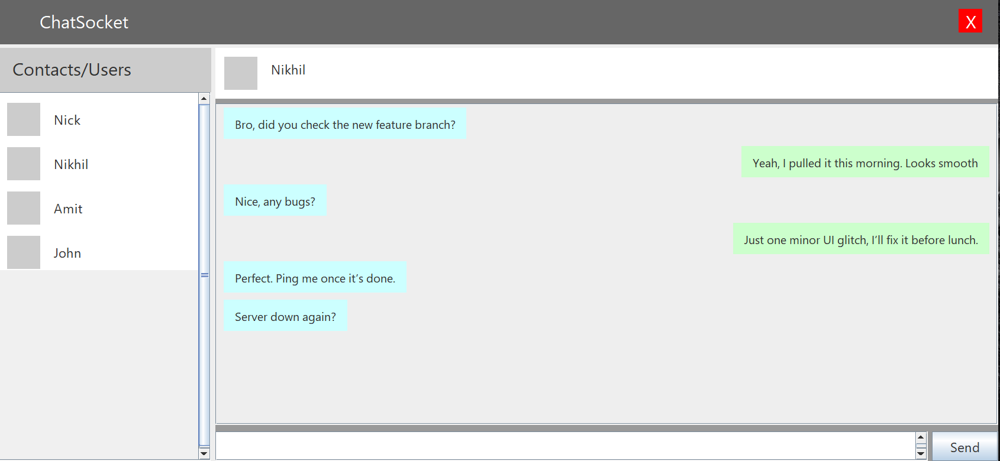

## ChatSocket
- **ChatSocket** is a multithreaded Java chat application that allows users to send and receive messages through a **visual chat interface** — just like WhatsApp — using **Java Sockets**, **JDBC**, and **XML** .

## Key Features : 
- Even if the user is not Online, Other users can text this user, and as soon as the user comes online and logs in the credentials, the user may recieve all the texts sent while he was offline !!
- All user data is stored in Database !
- Even if the system/ server crashers, The unsent messages will not be lost, they will be stored in file named as `uniqueId + 'Unread.xml'`, and automatically be sent when the system is live back, and user logs in!


## Features

- **Multithreaded Chat System** – Handles multiple clients concurrently with independent threads.  

- **Database Authentication (JDBC)** – Securely stores and validates users from a database.  

- **Graphical Chat Interface (Swing)** – Interactive chat screen similar to WhatsApp.  

- **O(1) User Search** – Uses HashMap for efficient user lookup.  

- **XML Storage** – Stores offline and unsent messages in local XML files.  

## Real Time View



## Concepts Used

### 1. Java Sockets
- Enables real-time communication between the **Client** and **Server** over TCP connections.  
- The `ServerSocket` class listens for incoming connections, while each client uses a `Socket` object to establish communication.  
- Allows full-duplex data exchange, forming the backbone of the chat system.

### 2. Multithreading
- Each client connection is handled by a **separate thread**, ensuring simultaneous message exchange between multiple users.  
- Prevents blocking operations by letting the server manage multiple clients concurrently.  
- Uses Java’s `Thread` and `Runnable` interfaces for parallel execution.

### 3. Swing GUI
- Provides a **graphical user interface** for users to chat visually instead of using the console.  
- Uses components like `JFrame`, `JPanel`, `JTextArea`, and `JButton` to display chat windows and message bubbles.  
- Offers a user-friendly experience similar to popular chat applications.

### 4. JDBC (Database Connectivity)
- Used for **storing and validating user credentials** (uniqueId and password).  
- Connects to relational databases like MySQL using Java’s `DriverManager` and `Connection` classes.  
- Ensures secure login and easy scalability for user management.

### 5. XML File Handling
- Stores **offline and unsent messages** in XML files.  
- When a user is offline, messages are written to `uniqueId + 'Unread.xml'` , ensuring data persistence.  
- Uses DOM or SAX parsers to read and write structured data efficiently.

### 6. HashMap-based Search
- Implements quick lookups for active users using Java’s `HashMap`.  
- Offers **O(1)** average time complexity for searching users or sessions.  
- Simplifies message routing between clients connected to the server.

### 7. Offline Message Synchronization
- Ensures messages sent while a user is offline are **not lost**.  
- When the user logs in again, all pending messages are retrieved from XML and displayed in the chat window.  
- This design maintains message continuity across sessions, even during server downtime.


## How to run this program!
1. Clone this project from this repository to your device!

2. Move to the src folder inside the GUI and SocketChat folder!

3. Run to compile the Server
    ```java
    javac -cp ".;drivers/sqlite-jdbc.jar" Server.java
    ```

4. Run to compile the Client
    ```java
    javac Client.java
    ```

5. Run ` java -cp ".;drivers/sqlite-jdbc.jar" Server` to start the Server.

6. Run ` java Client ` to enter as an Client/User.(Use Apache NetBeans for GUI view and press `Shift + F6` to run the client File!);

## Author

**Developed by:** Isha Patil  
Demonstrating advanced Java Multithreading, Socket Programming, Persistence and Various other Core and Advanced concepts.
